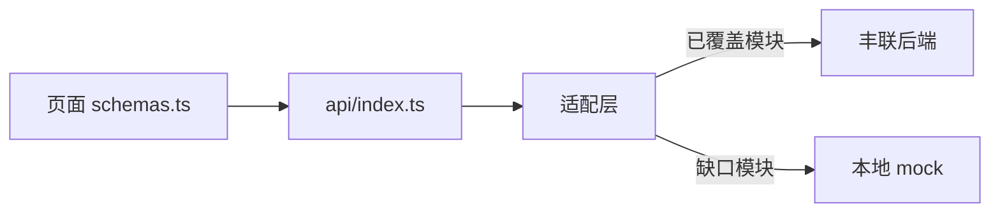

# 丰联仓储接口对接计划

> 整理日期：2026-10-06，基地址与契约文件于 2026-10-11 更新。适配层已接入 `frontend/`：`VITE_USE_MOCK=false` 时，下文「已覆盖」模块请求丰联接口，其余模块继续本地 mock。
>
> 来源：[对接文档/广西丰联仓储系统_接口文档.openapi.yaml](对接文档/广西丰联仓储系统_接口文档.openapi.yaml)（OpenAPI 3.1，版本 5.2.0）。开发环境 `servers` 为 `http://47.108.190.246:8090`。
> 现有前端：[frontend/src/api/index.ts](../frontend/src/api/index.ts)、[frontend/src/modules/schemas.ts](../frontend/src/modules/schemas.ts)。默认 `VITE_USE_MOCK=true`，响应为 `{ success, data, message }`。前端草案见 [API文档.md](API文档.md)。

后端是若依（RuoYi）风格，路径与字段和前端草案不一致，不能直接替换。对接时页面继续用现有中文字段；适配层负责路径、分页、枚举和主键。已覆盖模块走真实接口，文档未覆盖的页面保持本地 mock。

## 1. 协议差异

| 项 | 前端草案 | 丰联 OpenAPI |
|----|----------|----------------|
| 成功体 | `{ success, data, message }` | `{ code, msg, data }` |
| 分页 | `{ list, total, page, pageSize }` | `{ code, msg, rows, total }`，查询参数 `pageNum` / `pageSize` |
| 鉴权 | `POST /api/auth/login` | 头名 `Authorization`。`POST /login`，体为 `username`、`password`、`code`、`uuid`；验证码 `GET /captchaImage`；登录后再调 `GET /getInfo`、`GET /getRouters` |
| 主键 | 业务编码字符串（仓库编号、堆位编码、报关单号） | `int64` |
| 导出 | `GET`，返回 `{ filename, content }` | `POST` 文件流 |
| 基地址 | `VITE_API_BASE` 默认 `/api`，开发代理 `VITE_PROXY_TARGET` | 开发环境 `http://47.108.190.246:8090` |

列表查询把业务对象上的必填注解原样标成了 query `required`（例如入库列表的 `id`、`orcId`、`payableAmount`）。按若依惯例，这些查询参数实际可选。联调时按可选处理，并请后端修正文档。

下拉数据一律走各资源的 `listNoPage`。

## 2. 已覆盖，可对接

### 2.1 登录与账号

路径：`/login`、`/logout`、`/getInfo`、`/getRouters`、`/captchaImage`、`/system/user`、`PUT /system/user/profile/updatePwd`。

修改密码走 `POST /api/auth/password`，查询参数为 `oldPassword`、`newPassword`。密码策略、登录锁定和空闲超时由前端保存在本机，不映射丰联系统参数。服务端若拒绝口令或返回锁定，前端直接展示该提示。

| 前端 | 后端 |
|------|------|
| `username` | `userName` |
| `name` | `nickName` |
| `roleKey` | 角色（管理员 / 仓管员 / 关务员） |
| `phone` | `phonenumber` |
| `status` | `status` |

角色仍只保留管理员、仓管员、关务员。侧栏继续用 [frontend/src/nav.ts](../frontend/src/nav.ts)，用 `GET /getRouters` 过滤可见菜单。不照搬若依的菜单管理页、部门、公告、缓存和在线用户。

### 2.2 仓库 `/wms/warehouse`

| 前端 | 后端 |
|------|------|
| `code` | `warehouseCode` |
| `capacity` | `storageCapacity` |
| `area` | `area` |
| `stackCount` | `areaNum` |
| `rate` | `occupy` |
| `status` | `status` |

另有 `remark`、`orderNum`，页面暂不展示。支持新增、修改、详情、删除、分页列表、不分页列表、导出。

### 2.3 堆位 `/wms/area`

| 前端 | 后端 |
|------|------|
| `code` | `areaCode` |
| `warehouse` | `warehouseId`（下拉用仓库 id，展示用 `warehouse.warehouseName`） |
| `areaLabel` | `areaIdentification` |
| `capacity` | `inventoryCapacity` |
| `status` | `status` |

网格仍来自平面图占格，本接口没有格子。支持新增、修改、详情、删除、分页列表、不分页列表、导出。

### 2.4 物料 `/wms/item`

| 前端 | 后端 |
|------|------|
| `code` | `itemCode` |
| `name` | `itemName` |
| `cargoType` | `itemCategory` |
| `kind` | `type` |

文档里 `itemCategory` 与 `type` 的说明都写成了「货物类型」。联调时确认哪个是原料/成品，哪个是达标矿/报备矿/混成品。响应没有矿源字段。支持新增、修改、详情、删除、分页列表、不分页列表、导出。

### 2.5 往来单位 `/wms/merchant`

| 前端 | 后端 |
|------|------|
| 编码 | `merchantCode` |
| 名称 | `merchantName` |
| 电话 | `mobile` |
| 联系人 | `contactPerson` |
| 状态 | `status` |
| 角色 | `merchantType`（整数） |
| 来源 | `source`：0 手工维护，1 入库自动录入，2 出库自动录入 |

没有统一社会信用代码，与项目设计一致。支持新增、修改、详情、删除、分页列表、不分页列表、导出。委托方下拉在专用接口补齐前，可用 `listNoPage` 按 `merchantType` 过滤。

### 2.6 保税账册 `/wms/accountBook`

| 前端 | 后端 |
|------|------|
| 账册编号 | `accountCode` |
| 账册名称 | `accountName` |
| 经营单位 | `operatingUnit` |
| 货值 | `goodsValue` |
| 报关单号 | `customsDeclarationNumber` |
| 备案状态 | `filingStatus` |
| 衔接旧账 | `oldAccountId` / `oldAccountName` |
| 旧账预警日期 | `earlyWarningTime` |

列表可用 `beginEarlyWarningTime`、`endEarlyWarningTime` 做旧账预警时间范围。没有票矿明细和导出票矿。支持新增、修改、详情、删除、分页列表、不分页列表、导出列表。

### 2.7 货运方式 `/wms/shippingMethod`

独立档案：`shippingMethodCode`、`shippingMethodName`、`areaNumber`（柜数）。前端入库筛选目前写死「集装箱 / 散货」，对接后改为拉 `listNoPage`。支持新增、修改、详情、删除、分页列表、不分页列表。

### 2.8 系统参数

- `PUT /wms/system/params` 保存
- `GET /wms/system/params/{id}` 读取

| 字段 | 含义 |
|------|------|
| `thresholdAlter` | 库存预警阈值（库容占用%） |
| `agingAlert` | 原料库龄预警（天） |
| `dockAlert` | 码头仓库预警（天） |
| `usageAlert` | 矿源备案用量预警（%） |
| `elements[]` | 品质参数，`elementCode` / `elementName` |

`thresholdAlter` 疑似拼写，联调前与后端核对。

### 2.9 入库 `/wms/receiptOrder`

`POST` 是新建预约，`PUT` 是到货收货，不是通用改单。另有详情、删除、分页列表、导出。

预约字段：

| 前端 | 后端 | 说明 |
|------|------|------|
| OCR 任务 | `orcId` | OCR 入库报关单主键，预约必填 |
| 委托方 | `consignorId` | 必填 |
| 船名 | `shipName` | 请求为 int64，响应为 string |
| 提单号 | `waybillNo` | |
| 核注清单 | `verificationCode` | |
| 报关单号 | `recordNo` | |
| 币制 | `currency` | |
| 金额 | `payableAmount` | 必填 |
| 物料 | `itemId` | 必填 |
| 预定堆位 | `areaId` | 必填 |
| 矿种 | `mineralType` | 整数，必填 |
| 装运方式 | `shippingMethodId` | 必填 |
| 到货日期 | `arrivalDate` | |
| 物流账册主体 | `entityId` | |
| 账册 | `ebookId` | |
| 存放格子 | `areas[{row,column}]` | 列表回包另有 `areaItems` JSON 字符串 |

收货（`PUT`）必填：`receiptOrderId`、`receiptOrdeCode`、`mineralType`、`shippingMethodId`、`wetWeight`、`dryWeight`、`moistureContent`。另可带 `itemType`、`ebookId`、`remark`、`weightOrcId`（重量单 OCR）、`elementsOrcId`（品质单 OCR）、`elements[]`（`elementCode` / `elementValue`，文档称五项有害元素）。

列表可按 `mineralType`、`shippingMethodId`、`receiptOrderStatus`、`consignorId` 筛选。起止日期用 `params[beginTime]` / `params[endTime]`，该参数当前能通过。状态字典 `wms_receipt_status`：0 待收货、1 暂存码头、2 已入库、3 混成品、-1 作废。矿种字典 `wms_mineral_type`：1 精铜矿、2 冰铜。币制字典 `wms_currency_type`：1 人民币、2 美元。柜数取货运方式上的 `areaNumber`，预约体不单传柜数。前端表单有航次，预约体没有该字段。船名仍是整数，没有船名字典时只能填编号。

### 2.10 OCR `/wms/ocr`

- `POST /wms/ocr`：`multipart/form-data` 字段 `file`。查询参数 `ocrLogType` 必填，`orderNo` 可选。
- `PUT /wms/ocr`：修正。`result` 在回填归档时会修改关联单据。
- `GET /wms/ocr/{id}`、`GET /wms/ocr/list`。

| 码 | 含义 |
|----|------|
| `ocrLogType` 0 / 1 / 2 / 3 | 入库报关单 / 出库报关单 / 重量单 / 品质证书 |
| `ocrLogStatus` 0 / 2 / 3 | 待修正 / 回填 / 归档 |

没有提单类型。`orderId` 为 0 表示只归档；回填归档时填报关单、重量单或品质单 id。

### 2.11 操作日志

`GET /monitor/operlog/list`，可导出。映射到现有审计页：

| 前端 | 后端 |
|------|------|
| 操作人 | `operName` |
| 来源地址 | `operIp` |
| 时间 | `operTime` |
| 业务单号 | `businessNo` |
| 修改前后 | `operContent`（字段: 原值 → 新值） |
| 补充说明 | `operDetail` |

删除、清空、在线用户、登录日志清理、缓存监控不对接。

### 2.12 平面图

`GET /wms/floorPlan/listNoPage` 取平面图记录，`POST /wms/floorPlan` 新增，`PUT /wms/floorPlan` 修改。请求体只有整图 JSON 字符串 `jsonData`，修改时再带记录 `id`。列表没有带上 JSON 时，再请求 `GET /wms/floorPlan/{id}`。

前端仍用 `GET/PUT /floor-plans`。保存时把 `{ id, gridPx, gridCols, gridRows, items }` 序列化成 `jsonData` 上传。平面图设置和驾驶舱都读服务器上的这一份。有多条记录时用更新时间最新的一条。服务器还没有记录、浏览器里仍有图块时，第一次读取会先把本机 JSON 上传，避免已画的图被空网格盖住。

## 3. 文档未覆盖，继续 mock

这些页面在 OpenAPI 中没有对应路径。对接开关保持 mock，并向后端提补齐清单：

- 矿源备案及票货、备案导出
- 驾驶舱汇总（平面图本身已从 `/wms/floorPlan` 读取，KPI、趋势、作业流水仍是 mock）
- 移库、批量移库
- 库存查询、本票详情、干湿重台账
- 盘点、按月在库导出
- 库存预警（库容、库龄、码头超期、旧账转入）
- 生产投料、完工入库、查验改成品区
- 出库单、审核；出库报关单回填后的流向企业自动建档（往来单位已有 `source=2`，但没有出库单接口）
- 关务账实对账、差异穿透、联网申报、账册核销
- 账册票矿、物料矿源

字典管理已进入系统菜单，维护字典类型和字典值。堆位片区标识、物料货物类型和类型、往来主体角色的下拉改为读对应字典。其余业务页暂不改现有字典读取，字典接口仍在矿种、入库状态等枚举没有书面取值时用来查码表。部门、公告、缓存、在线用户不进业务菜单。

## 4. 前端接入

`frontend/src/api/http.ts` 在 `VITE_USE_MOCK=false` 时，只把 `VITE_LIVE_MODULES` 中的模块交给 `frontend/src/api/fenglian.ts`。未列入的已覆盖路径继续本地 mock。适配层把 `{ code, msg, rows }` 收成页面使用的 `{ success, message, list }`，并完成字段、主键和枚举转换。令牌写入 `sessionStorage` 键 `wms_token`，请求头为 `Authorization`。

本地开发已把 `frontend/.env` 的 `VITE_PROXY_TARGET` 设为 `http://47.108.190.246:8090`。`VITE_USE_MOCK=false`。`VITE_LIVE_MODULES` 当前为 `auth,settings,warehouses,stacks,materials,partners,bonded,shipping,inbound,ocr,audit,dicts,floor`。`VITE_API_BASE` 保持 `/api`，由 Vite 去掉前缀后转发。系统参数主键用 `VITE_SYSTEM_PARAM_ID`（默认 `1`）。令牌前缀用 `VITE_TOKEN_PREFIX`（默认 `Bearer `）。当前开发环境验证码关闭。

登录、验证码、退出始终请求丰联。当前开发环境验证码关闭，登录页不展示验证码，也不再切换本地演示账号。入库预约提交 OCR 任务编号、物料、委托方、堆位和货运方式；船名只接受字典编号，航次不提交。到货收货在状态为「待收货」的编辑里填写湿重、干重、水分。柜数只展示货运方式的 `areaNumber`。OCR 上传使用原始文件，提单类型直接提示暂不支持。物料导出接收 Excel 文件流。矿源不提交。账册票矿和堆位查验完成提示后端未提供。角色勾选仍是前端菜单，保存时提示到丰联后台维护；侧栏按 `GET /getRouters` 与本地三角色取交集，并保留概览。一条都对不上时回退到该角色的默认菜单。品质参数保存元素编号、名称，以及是否有害、是否报税（1 是，0 否）。

## 5. 对接顺序

下列顺序已在适配层接通，并写入 `VITE_LIVE_MODULES`。未写入白名单的模块即使 `VITE_USE_MOCK=false` 也继续 mock。

1. **基线**：`VITE_API_BASE` 保持 `/api`，`VITE_PROXY_TARGET` 指向 `http://47.108.190.246:8090`。`VITE_USE_MOCK=false` 配合 `VITE_LIVE_MODULES` 按模块生效。HTTP 层把 `code/msg/rows` 收成现有 `success/message/list`。登录写入 Token。
2. **登录与账号**：验证码、登录、用户信息、路由、用户增改。侧栏仍用三角色。角色菜单在丰联后台维护。
3. **基础档案**：仓库、堆位、物料、往来单位、账册、货运方式、系统参数。仓库和货运方式下拉走 `listNoPage`。堆位查验完成、账册票矿没有路径，页面提示未提供。
4. **入库与 OCR**：先上传原始文件识别，拿到 `orcId` 再预约；提单不发请求。到货收货走 `PUT /wms/receiptOrder`。柜数取货运方式的 `areaNumber`。船名对不上字典编号时拦截。起止日期若被拒绝则去掉后再查。
5. **操作日志**：列表映射到审计页。删除、清空不开放。
6. **平面图**：整图 JSON 写入 `jsonData`。平面图设置保存时上传，驾驶舱打开时从 `listNoPage` 读回。
7. **缺口**：库存、移库、盘点、生产、出库、关务、驾驶舱汇总、矿源备案仍用 mock，等后端补路径后再开适配。

## 6. 需后端确认

- 成功码是否仅 `code=200`。开发环境基地址已确认为 `http://47.108.190.246:8090`。登录令牌在 `data.token`，须带 `Bearer ` 前缀；不带前缀时 `GET /getInfo` 返回 401。该环境 `GET /captchaImage` 返回 `captchaEnabled: false`。登录、验证码、退出始终请求丰联。其余已覆盖模块看 `VITE_LIVE_MODULES`。
- 入库状态字典是 `wms_receipt_status`（0 待收货、1 暂存码头、2 已入库、3 混成品、-1 作废）。矿种是 `wms_mineral_type`（精铜矿、冰铜）。币制是 `wms_currency_type`（1 人民币、2 美元）。收货分类 `itemType` 用 `wms_item_type`（原料、成品）。
- 预约请求里 `shipName` 为整数。前端先查 `wms_ship_name`、`wms_ship`，查不到则只接受数字编号，不提交船名文本。
- 入库列表的时间范围、航次字段。前端已不提交航次。带起止日期的列表若失败，会去掉日期重试，并提示待后端补 `beginTime` / `endTime`。
- `receiptOrdeCode`、`orcId`、`weightOrcId`、`elementsOrcId`、`thresholdAlter` 是否为笔误。
- 开发环境实测：`GET /wms/item/list` 报未知列 `type`；`GET /wms/merchant/list` 与 `listNoPage` 报未知列 `status`；`GET /wms/accountBook/list` 报数据表不存在；`GET /wms/receiptOrder/list` 报未知列 `o.itemId`。这些是库表与契约不一致，前端已按契约请求，需后端改表或改查询。
- 到货收货体含「五项有害元素」。项目设计约定预约与到货登记不提交五项有害元素，品质八项记在上架后的本票库存。需确认收货接口是否只接收重量，元素改由 OCR 品质单回填。
- OCR 是否补提单；账册是否补票矿；物料是否补矿源。
